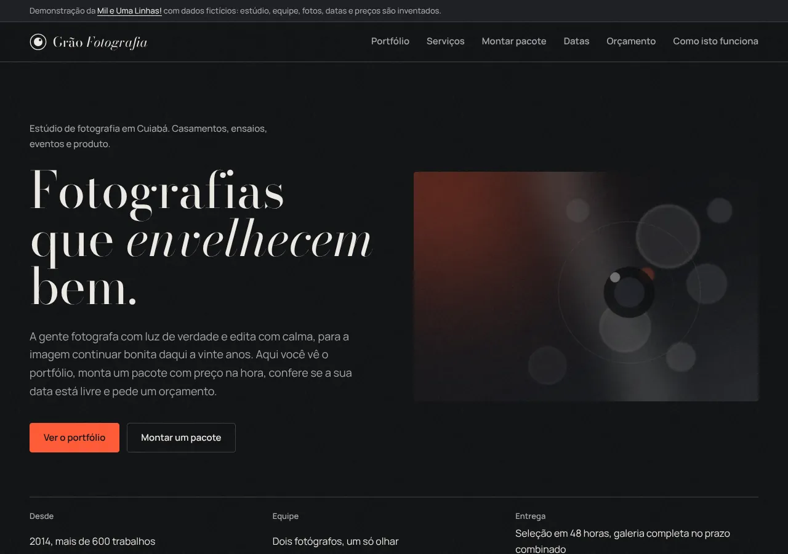
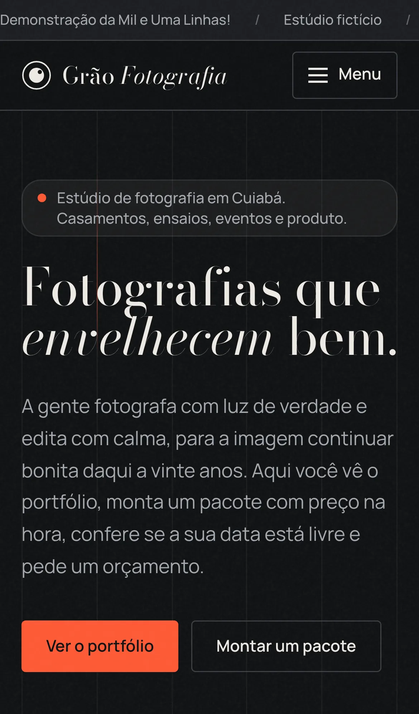
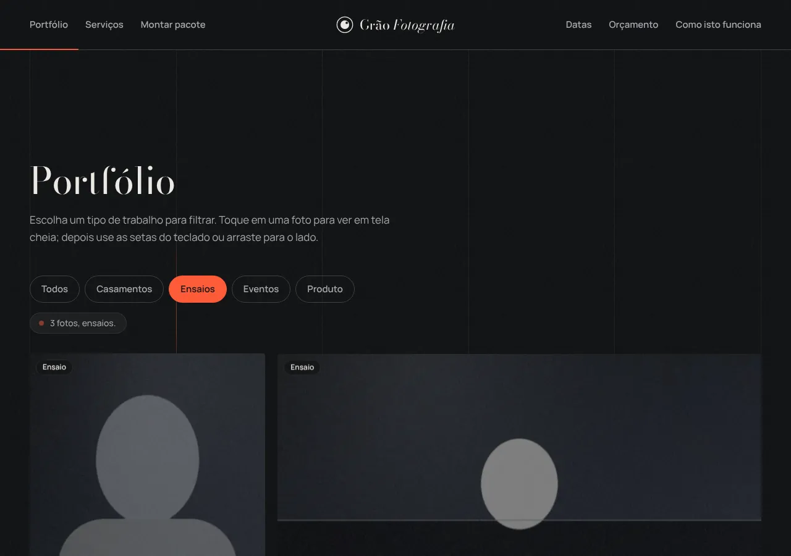
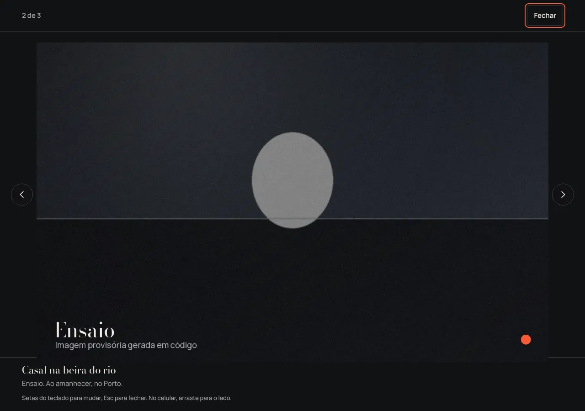
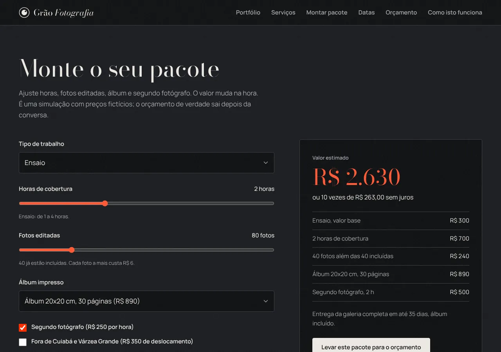
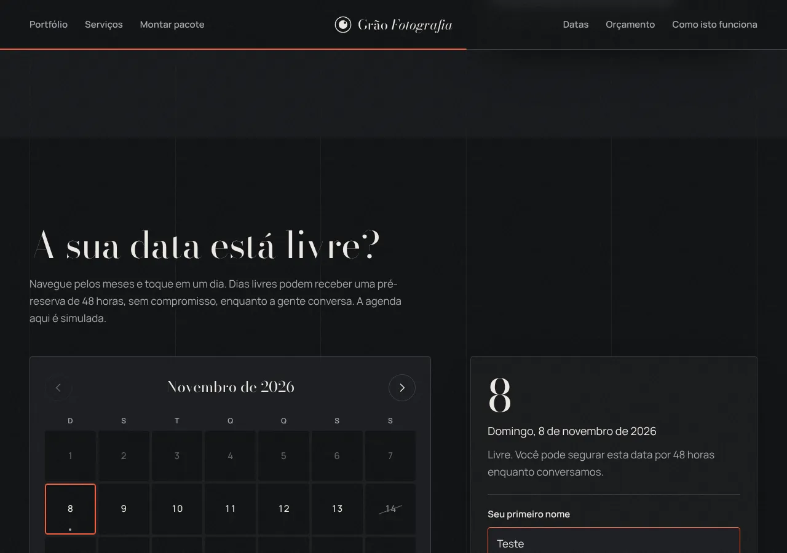
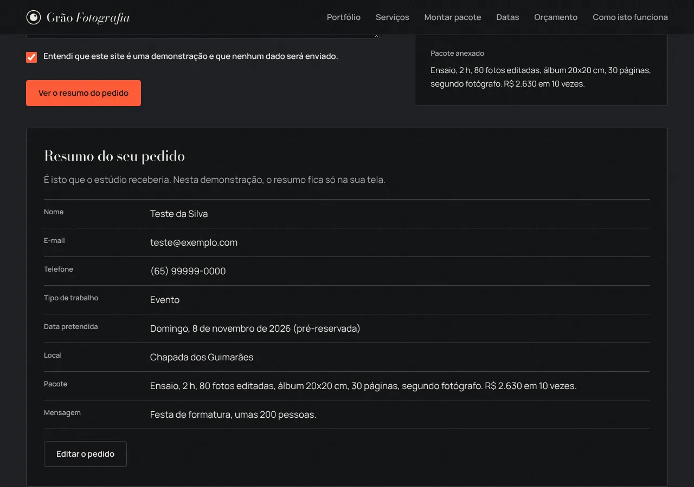

# Grão Fotografia

Site de demonstração de um estúdio de fotografia. Eu, Rodrigo Jr, da [Mil e Uma Linhas!](https://mileumalinhas.com.br), fiz este site para mostrar a fotógrafas e fotógrafos o que um site próprio pode fazer: mostrar o portfólio do jeito que a foto merece, deixar a pessoa montar um pacote com preço na hora, conferir se a data está livre e pedir um orçamento sem precisar de ninguém do outro lado.

Endereço quando publicado: https://toshiro01001.github.io/fotografia/

**Tudo aqui é fictício.** O estúdio Grão não existe. Fotógrafos, endereço, telefone, e-mail, preços, agenda e as "fotos" foram inventados. **As fotografias do hero, do estúdio, da equipe, dos bastidores e do set de produto foram geradas por IA no Canva e são ilustrativas**: não mostram pessoas nem lugares reais. As imagens do portfólio são composições geradas em código, provisórias, no lugar das fotografias reais que entrariam no site de um estúdio de verdade. Nada é vendido, cobrado ou enviado; nenhum dado sai do seu aparelho.

## Capturas

| Computador | Celular |
|---|---|
|  |  |

| Portfólio com filtro | Foto em tela cheia |
|---|---|
|  |  |

| Montador de pacote | Datas com pré-reserva |
|---|---|
|  |  |

| Resumo do orçamento |
|---|
|  |

No celular: [tela cheia](docs/celular-visor.webp), [pacote](docs/celular-pacote.webp), [datas](docs/celular-datas.webp) e [orçamento](docs/celular-orcamento.webp).

## Fotos geradas por IA (Canva)

Todas ilustrativas, feitas no Canva a partir dos prompts do plano visual, com a mesma luz: fundo quase preto, luz fria lateral e um único brilho vermelho de sala de revelação.

| Arquivo | Tamanho | Onde aparece |
|---|---|---|
| `img/hero.webp` | 1620x1080 (3:2) | Abertura |
| `img/servico-produto-set.webp` | 1456x816 (16:9) | Cartão "Produto" em Serviços e pilha de amostras do montador |
| `img/estudio-sala.webp` | 1456x816 (16:9) | Foto larga em "O estúdio" |
| `img/equipe-helena.webp` | 1088x1456 (3:4) | Retrato da Helena Vilar em "O estúdio" |
| `img/equipe-caio.webp` | 1088x1456 (3:4) | Retrato do Caio Monteiro em "O estúdio" |
| `img/bastidores-revelacao.webp` | 1152x1440 (4:5) | Ao lado do texto de "Como isto funciona" |

Para trocar uma foto, salve outra com o mesmo nome e a mesma proporção em `img/`; se o tamanho mudar, ajuste `width` e `height` da tag `` no `index.html`.

## O que o site faz

1. **Portfólio com filtro e tela cheia.** Toque em Casamentos, Ensaios, Eventos ou Produto e a grade mostra só aquele tipo. Toque em uma foto para abrir em tela cheia; as setas do teclado trocam a foto, Esc fecha e, no celular, dá para arrastar para o lado. O contador mostra em qual foto você está dentro do filtro escolhido.
2. **Montador de pacote.** Escolha o tipo de trabalho e mexa nas horas de cobertura, no número de fotos editadas, no álbum impresso, no segundo fotógrafo e no deslocamento. O valor, o detalhamento linha a linha, as parcelas e o prazo de entrega mudam na hora. O botão "Levar este pacote para o orçamento" anexa a simulação ao pedido.
3. **Datas disponíveis com pré-reserva.** Navegue pelos próximos 12 meses. Dias riscados estão reservados; os outros estão livres. Em um dia livre, escreva seu primeiro nome e segure a data por 48 horas (simulação). Se marcar a caixa, a pré-reserva fica guardada no seu navegador; dá para apagar quando quiser. O botão "Pedir orçamento para esta data" leva a data e o tipo para o formulário.
4. **Atalhos por tipo.** A faixa "Ver o portfólio por tipo de trabalho" (e os links de Serviços no rodapé) já marcam o filtro certo e levam até a grade.
5. **Pedido de orçamento.** O formulário confere nome, e-mail, telefone, data e a caixa de ciência, aponta cada erro ao lado do campo e, quando está tudo certo, mostra um resumo do pedido na tela, com o pacote anexado e a data pré-reservada. Nada é enviado.

## Como usar

1. Abra o site no celular ou no computador.
2. Em "Portfólio", toque em um dos filtros e depois em uma foto. Use as setas ou arraste para ver as outras.
3. Em "O que a gente fotografa", toque em "Montar pacote" de um dos serviços e ajuste os controles em "Monte o seu pacote". Veja o valor mudar e toque em "Levar este pacote para o orçamento".
4. Em "A sua data está livre?", toque em um dia sem risco, escreva seu primeiro nome e confirme a pré-reserva. Depois toque em "Pedir orçamento para esta data".
5. Em "Peça um orçamento", complete o que faltar, marque a caixa e toque em "Ver o resumo do pedido".

## Identidade visual

Estudo completo em [docs/identidade.md](docs/identidade.md). Resumo:

- **Nome e frase:** Grão Fotografia. "Fotografias que envelhecem bem."
- **Paleta:** Breu `#111214` (fundo), Chumbo `#1C1E22` (superfícies), Grafite `#3B3F46` (bordas), Papel fotográfico `#EDEAE4` (texto), Prata `#A6A9AF` (texto de apoio) e Luz de segurança `#FF5A36` (o único destaque, um por tela).
- **Fontes:** Bodoni Moda (títulos e números grandes, com o tamanho óptico no máximo para as serifas virarem fio) e Manrope (texto e interface). Ambas locais, SIL OFL.
- **Por quê:** escolhi o fundo escuro de sala de revelação, não o branco de galeria, porque em site de fotógrafo a única coisa que pode brilhar é a foto. A luz vermelha de sala escura é a cor mais específica do universo da fotografia; o grão fino sobre a página inteira é o detalhe que dá nome ao estúdio. Fugi do preto com dourado e da letra cursiva de convite de casamento: o itálico da Bodoni em uma palavra por título faz o papel editorial.
- **Imagem forte:** uma fotografia no hero, em contêiner 3:2. A imagem em `img/hero.webp` é uma foto gerada por IA no Canva (1620x1080), feita a partir do prompt da seção "Foto do hero" de `docs/identidade.md`. As fotos do portfólio continuam provisórias.
- **Leva final (design systems):** a superfície mistura o Lumina (fundo com grade de fios e feixes de luz que caem, vidro fosco, numerais leves, marca gigante no rodapé) com a estrutura editorial do Sable (faixa que rola no topo, menu com trilho de progresso, placas de foto, categorias, contadores, rodapé em colunas). A paleta não mudou. Lista completa em `docs/identidade.md`, seção "Design systems aplicados (leva final)".

## Como funciona por dentro

O site é um conjunto de arquivos que o navegador baixa e roda sozinho, sem servidor de aplicação.

- `index.html` tem todas as seções em uma página só, com âncoras no menu. A grade do portfólio é HTML comum, com `data-tipo` em cada item; o filtro só esconde e mostra.
- `css/estilo.css` tem a identidade: cores em variáveis, as duas fontes locais, a grade do portfólio com `grid-auto-flow: dense`, o visor em tela cheia, o calendário e os formulários. O grão é uma imagem pequena repetida por cima da página, quase transparente. A grade de fios com os feixes de luz, a faixa que rola, a pílula que pulsa e a pilha de cartões são só CSS (transform e opacity) e param com "reduzir movimento" ligado no aparelho. O desfoque de vidro dos painéis só liga em telas de 900px para cima, para não pesar no celular.
- `js/dados.js` tem a tabela fictícia de preços (valor base, hora, fotos incluídas, prazo) e os dados do estúdio.
- `js/app.js` faz o resto: trilho de progresso no menu (atualizado uma vez por quadro durante a rolagem), contadores que sobem quando aparecem, revelação dos blocos ao rolar (com `IntersectionObserver`), atalhos de categoria que marcam o filtro, passo ativo e pilha de amostras do montador, filtro e visor (elemento `<dialog>` nativo, com setas, Esc e arraste), cálculo do pacote, calendário com dias reservados "sorteados" por uma regra fixa (por isso a agenda é a mesma para todo mundo), pré-reservas e validação do orçamento.

## Detalhes técnicos

- HTML, CSS e JavaScript puros. Sem framework, sem biblioteca, sem CDN, sem fonte externa, sem analytics.
- `Content-Security-Policy` por `meta`: `default-src 'self'; script-src 'self'; style-src 'self'; img-src 'self' data:; font-src 'self'; connect-src 'none'; object-src 'none'; base-uri 'self'; form-action 'none'`. Sem script inline, sem estilo inline, sem `onclick`.
- Acessibilidade: contraste AA em todos os textos (Papel sobre Breu 16:1, Prata sobre Breu 7,6:1, Luz de segurança sobre Breu 6:1), foco visível, navegação por teclado no filtro, no visor e no calendário, `alt` em todas as imagens, `aria-live` nos resultados, `lang="pt-BR"`, `prefers-reduced-motion` respeitado.
- Imagens em `webp` com `width` e `height` declarados. Fotos do portfólio com `loading="lazy"` a partir da terceira.
- `404.html` com caminhos absolutos `/fotografia/...`, `robots.txt`, `sitemap.xml` e arquivo de verificação do Google.

## Como rodar

1. Baixe a pasta.
2. Na pasta, rode `python3 -m http.server 8313` (ou qualquer servidor de arquivos).
3. Abra `http://localhost:8313/` no navegador.

Abrir o `index.html` direto com dois cliques também funciona para olhar, mas as fontes podem não carregar por causa da política de segurança do navegador em arquivos locais.

## Testes

`tests/site.cjs` usa Playwright e cobre três telas: computador (1280x900), iPhone 13 e um celular estreito de 320px. Em cada uma verifica: rolagem horizontal, elementos passando da borda, texto cortado, erros de console, foto do hero carregada, filtro do portfólio, visor (abrir, setas, volta no fim, arraste, Esc, foco de volta), montador (valores, linhas, parcelas, prazo, anexar), calendário (dia livre, dia reservado, pré-reserva com e sem nome, localStorage, apagar), orçamento (erros, resumo, editar), menu no celular e página 404.

Para rodar: sirva a pasta na porta 8313 e execute `node tests/site.cjs`. Com `CAPTURAS=pasta` ele salva capturas de cada etapa.

## Segurança

Vistoria em [docs/vistoria.md](docs/vistoria.md). Em resumo: CSP restritiva, nenhum envio de dados, nenhuma dependência em tempo de execução, `localStorage` só com a chave `grao-prereservas` e só se a pessoa marcar a caixa, com botão para apagar. O repositório não tem senha, chave nem dado pessoal.

---

Site feito pela [Mil e Uma Linhas!](https://mileumalinhas.com.br), Cuiabá.
